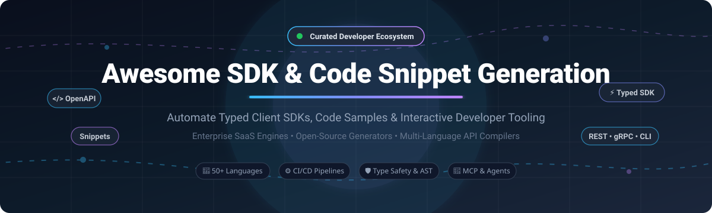

# ⚡ Awesome SDK &amp; Code Snippet Generation 🛠️

  <strong>A curated directory of top SDK and Code Snippet Generation platforms, automated API compilers, and developer tooling ecosystems.</strong>

  <em>Generate production-ready typed client libraries (TypeScript, Python, Go, Java, C#, PHP, Swift, Rust), interactive code documentation samples, and AI MCP servers from OpenAPI, AsyncAPI, and gRPC specs.</em>

---

## 📑 Table of Contents

- [🌐 Sector Overview & Market Dynamics](#-sector-overview--market-dynamics)
- [🟦 SaaS / Hosted Platforms](#-saas--hosted-platforms)
- [🟩 Open-Source Software](#-open-source-software)
- [📊 Comparison at a Glance](#-comparison-at-a-glance)
- [📈 Star History](#-star-history)
- [💖 Support & Sponsorship](#-support--sponsorship)
- [🤝 Contributing](#-contributing)
- [📄 License](#-license)

---

## 🌐 Sector Overview & Market Dynamics

The global API management and client SDK generation market was valued between **$7.0B and $7.68B in 2024**, on track to surpass **$9.5B+ by 2025** at a compound annual growth rate (CAGR) of **~17–20%**, propelled by microservices adoption, spec-driven development, and AI agent integration (MCP servers).

The market is **moderately fragmented**: mega-cap API platforms (like Postman through its acquisitions of Fern and liblab) dominate high-volume enterprise API workflows, while specialized SDK infrastructure innovators (Speakeasy, APIMatic) and an indispensable core of battle-tested open-source code generators (OpenAPI Generator, Kiota, TypeSpec) power developer toolchains and community standards across millions of repositories worldwide.

---

## 🟦 SaaS / Hosted Platforms

Below is an overview of commercial, cloud-hosted SDK and Code Snippet Generation platforms, ranked in descending order of vendor scale (company valuation and annual revenue).

| Solution | Vendor Scale (Valuation / Revenue) | Key Focus & Capabilities | Starting Tier Pricing | Free Tier Limits / Free Trial |
| :--- | :--- | :--- | :--- | :--- |
| **[Postman Code Examples](https://www.postman.com/)** | **$5.6B valuation** (~$313M+ ARR) | Multi-language instant request snippet generator integrated into Postman API platform (cURL, Python, Node.js, Go, etc.) | **$19/user/month** (Team plan, billed annually) | **Free forever plan**: Single user, up to 10,000 Postman API calls/month, unlimited collection runs, up to 5 integrations |
| **[liblab](https://liblab.com/)** | **Acquired by Postman** ($50M venture funding raised) | Automated SDK-as-a-service with CI/CD orchestration, architectural optimization, and multi-language support | **$300/month** (Starter tier for up to 3 APIs with all languages; MCP generator at $5 per 100 calls) | **Free tier**: 100 MCP calls/month for the first year (Free for eligible non-commercial open-source projects) |
| **[Fern](https://buildwithfern.com/)** | **Acquired by Postman** (~$33M estimated acquisition value; $13M raised) | Type-safe multi-language SDK generator & modern documentation builder supporting OpenAPI, AsyncAPI, and gRPC | **$250/month per SDK** (Starter tier for up to 50 endpoints; Docs standalone starts at $0) | **Free forever plan**: 200 endpoints for Python & TypeScript SDKs; 1 documentation site with 1,000 pages, 10 team members, and 250 AI credits/month |
| **[Speakeasy](https://www.speakeasy.com/)** | **$25.9M funding raised** (Series A led by FPV & Google Ventures) | Enterprise SDK compiler, CLI generator, Terraform provider generator, and AI Model Context Protocol (MCP) server creation | **Pay-as-you-go** ($0 fixed platform fee; $0.35/1M session storage tokens, $0.99/1M risk tokens, $20/GiB MCP egress) | **Free forever plan**: 1 SDK target with up to 50 API operations/methods & community support; 14-day enterprise free trial |
| **[APIMatic](https://www.apimatic.io/)** | **~$5.1M annual revenue** (Bootstrapped / Seed stage) | Developer experience platform with automatic SDK generation, API portal builder, and live code sample documentation | **$10/month** (Lite tier for 1 API portal; Basic SDK tier at $300/month per language) | **14-day free trial** with full feature access (no permanent free public production deployment tier) |

---

## 🟩 Open-Source Software

Self-hosted, community-driven SDK and Code Snippet Generation tools. Sorted in descending order of GitHub stargazers.

| Project | GitHub_Stars | Stack | License | Key Capabilities & Highlights |
| :--- | :--- | :--- | :--- | :--- |
| **[Insomnia](https://github.com/Kong/insomnia)** |  | TypeScript / Electron | Apache-2.0 | Desktop API development platform and client containing automated multi-language code snippet generation (`httpsnippet` engine) across 30+ language and library targets. |
| **[OpenAPI Generator](https://github.com/OpenAPITools/openapi-generator)** |  | Java / Mustache | Apache-2.0 | The open-source standard for API code generation. Provides 50+ client SDK generators, 40+ server stubs, and schema documentation generators with complete OpenAPI 2.0/3.0/3.1 support. |
| **[Swagger Codegen](https://github.com/swagger-api/swagger-codegen)** |  | Java / Mustache | Apache-2.0 | The founding code generation engine of the Swagger ecosystem. Generates client SDKs in 40+ languages and server stubs for OpenAPI 2.0 and OpenAPI 3.0 definitions. |
| **[oapi-codegen](https://github.com/oapi-codegen/oapi-codegen)** |  | Go | Apache-2.0 | High-performance Go client and server code generator from OpenAPI 3 specifications, supporting Chi, Echo, Gin, Fiber, and native `net/http`. |
| **[TypeSpec](https://github.com/microsoft/typespec)** |  | TypeScript | MIT | Microsoft's programmatic API design language that compiles into OpenAPI, JSON Schema, and client SDKs, powering Azure API definitions with concise, type-safe syntax. |
| **[Hey API (openapi-ts)](https://github.com/hey-api/openapi-ts)** |  | TypeScript | MIT | Next-generation TypeScript SDK generator from OpenAPI specifications, featuring TanStack Query integration, native Fetch, Axios, Angular client support, and Zod validator output. |
| **[Kiota](https://github.com/microsoft/kiota)** |  | C# / .NET CLI | MIT | Microsoft's client generator producing lightweight, strongly-typed SDKs with selective endpoint slicing to keep client bundle size minimal (supports C#, Go, Java, PHP, Python, TypeScript). |
| **[Fern (Core CLI & Generators)](https://github.com/fern-api/fern)** |  | TypeScript / Java | Apache-2.0 | Permissively licensed compiler and generator engine converting OpenAPI, AsyncAPI, and Fern definitions into idiomatic client SDKs across TypeScript, Python, Java, Go, Ruby, C#, and Rust. |
| **[Swagger JS](https://github.com/swagger-api/swagger-js)** |  | JavaScript | Apache-2.0 | Official Swagger/OpenAPI library that resolves spec dereferencing and exposes dynamic runtime HTTP client execution for browser and Node.js environments. |
| **[Redocly CLI](https://github.com/Redocly/redocly-cli)** |  | TypeScript | MIT | Modern API CLI with a built-in `generate-client` command creating production-grade TypeScript, Python, Go, and PHP clients with built-in retries, pagination iterators, and Server-Sent Events (SSE). |
| **[HTTP Snippet](https://github.com/Kong/httpsnippet)** |  | TypeScript | MIT | Library for translating HTTP request objects (HAR specification) into executable code snippets across 30+ programming languages and frameworks (cURL, Python, Node.js, Go, PHP, etc.). |
| **[OpenAPI Zod Client](https://github.com/astahmer/openapi-zod-client)** |  | TypeScript | MIT | Generates a full TypeScript API client accompanied by runtime Zod validation schemas directly from OpenAPI specs with end-to-end type safety. |
| **[Speakeasy OpenAPI Generation](https://github.com/speakeasy-api/openapi-generation)** |  | Go / TypeScript | AGPL-3.0 | Speakeasy's open-source generator core producing enterprise-grade client libraries, CLI tools, Terraform custom providers, and Model Context Protocol (MCP) server stubs. |
| **[Snippettoni](https://github.com/ffaraone/snippettoni)** |  | Python | Apache-2.0 | Python CLI tool that automatically generates and injects multi-language code samples (`x-codeSamples` vendor extension) into OpenAPI specifications for documentation rendering. |

---

## 📊 Comparison at a Glance

| Solution | Deployment | License | Primary Languages Supported | Server Stubs | Code Samples / Snippets | AI MCP Server Generation |
| :--- | :--- | :--- | :--- | :---: | :---: | :---: |
| **Postman** | SaaS | Proprietary | 20+ Languages (cURL, Python, JS, Go...) | ❌ | ✅ Native | ❌ |
| **liblab** | SaaS | Proprietary | TS, Python, Go, Java, C#, PHP | ❌ | ✅ Built-in | ✅ Native |
| **Fern** | SaaS / CLI | Apache-2.0 | TS, Python, Java, Go, Ruby, C#, Swift, Rust | ❌ | ✅ Built-in | ❌ |
| **Speakeasy** | SaaS / CLI | AGPL-3.0 | TS, Python, Go, Java, C#, PHP, Ruby, Unity | ❌ | ✅ Built-in | ✅ Native |
| **APIMatic** | SaaS | Proprietary | TS, Python, C#, Java, PHP, Ruby, Go | ❌ | ✅ Built-in | ❌ |
| **Insomnia** | Desktop / OSS | Apache-2.0 | 30+ targets (via HTTP Snippet) | ❌ | ✅ Native | ❌ |
| **OpenAPI Generator** | CLI / Docker | Apache-2.0 | 50+ Client Languages | ✅ 40+ Stubs | ✅ Templates | ❌ |
| **Swagger Codegen** | CLI / Java | Apache-2.0 | 40+ Client Languages | ✅ 20+ Stubs | ✅ Templates | ❌ |
| **oapi-codegen** | CLI / OSS | Apache-2.0 | Go (Chi, Echo, Gin, Fiber, Stdlib) | ✅ Stubs | ✅ Handlers | ❌ |
| **TypeSpec** | CLI / Node | MIT | Polyglot (Emits OpenAPI / TS / C#) | ❌ | ✅ Emitters | ❌ |
| **Hey API (openapi-ts)**| CLI / Node | MIT | TypeScript, JavaScript | ❌ | ✅ TanStack/Fetch | ❌ |
| **Kiota** | CLI / .NET | MIT | C#, Go, Java, PHP, Python, TS | ❌ | ✅ Snippets | ❌ |
| **Redocly CLI** | CLI / Node | MIT | TypeScript, Python, Go, PHP | ❌ | ✅ Client Docs | ❌ |
| **HTTP Snippet** | Library / OSS | MIT | 30+ Code Sample Runtimes | ❌ | ✅ Dedicated | ❌ |
| **OpenAPI Zod Client** | CLI / Node | MIT | TypeScript (with runtime Zod) | ❌ | ✅ Typed hooks | ❌ |
| **Snippettoni** | CLI / Python | Apache-2.0 | Multi-language `x-codeSamples` | ❌ | ✅ Dedicated | ❌ |

---

## 📈 Star History

---

## 💖 Support & Sponsorship

If this curated repository saved you development time, made your SDK generation pipeline smoother, or helped you choose the right API tooling, please consider showing your support:

- 🌟 **Star this repository** to help other developers discover it!
- 🍴 **Fork and contribute** your favorite generators, plugins, or improvements.
- 📢 **Share with colleagues** and developer communities on X/Twitter, LinkedIn, and Discord.
- ☕ **Buy a coffee & sponsor**: Support ongoing research, open-source benchmarking, and active curation via the [GitHub Sponsors Dashboard](https://github.com/sponsors/ishandutta2007).

---

## 🤝 Contributing

Contributions are warmly welcome! Whether you are maintaining a new open-source SDK generator, built an OpenAPI code sample plugin, or want to update documentation details, please feel free to submit a pull request:

1. Check that the project is actively maintained (active releases or commits within the last 12 months).
2. Ensure the repository has genuine relevance to SDK or code snippet generation.
3. Submit a pull request with the project name, official URL, stack/license, and a concise summary of why it stands out.

---

## 📄 License

This curated list is released under the [CC0 1.0 Universal (Public Domain)](LICENSE). All featured software projects, brand names, and trademarks belong to their respective owners.
